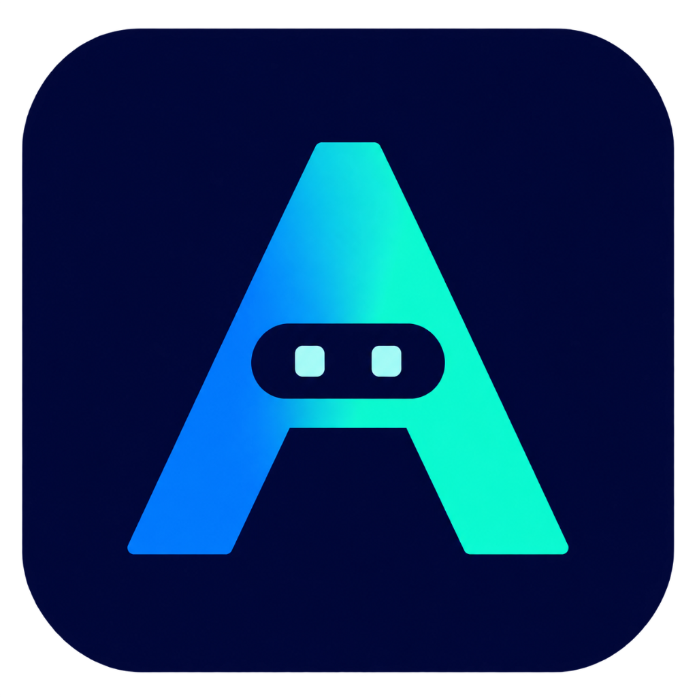
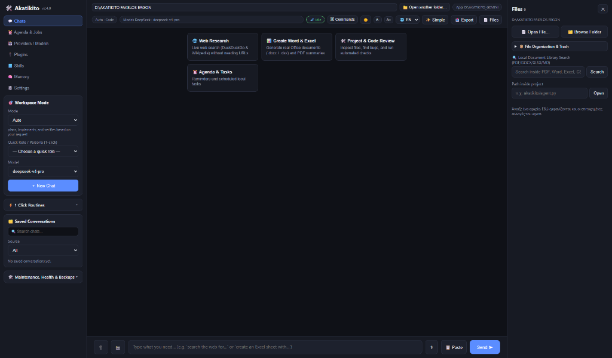

<p align="center">
  
</p>

# Akatikito — Local-First Desktop & Android AI Agent

[](https://github.com/rodos4312/akatikito-ai/releases/tag/v2.6.0)
[](https://github.com/rodos4312/akatikito-ai/releases/tag/v2.6.0)
[](https://rodos4312.github.io/akatikito-ai/)
[](#multi-language-interface)
[](LICENSE)

**Akatikito** is a local-first AI assistant for Windows (with an optional Android app) that runs in its own window and keeps your files, API keys, and memory privately on your own computer.

## Start in 5 Minutes (No Python Needed) / Ξεκίνα σε 5 λεπτά

- **Ελληνικός οδηγός (5 βήματα με εικόνες):** [docs/GETTING-STARTED.el.md](docs/GETTING-STARTED.el.md)
- **English guide (5 steps with images):** [docs/GETTING-STARTED.en.md](docs/GETTING-STARTED.en.md)

1. Download **`Akatikito-v2.6.0-portable.zip`** from [Releases](https://github.com/rodos4312/akatikito-ai/releases) *(Python 3.11 + all packages included)*.
2. Right-click → **Extract All**.
3. Double-click **`AkatikitoApp.cmd`** *(if Windows SmartScreen appears, click **More info → Run anyway**)*.
4. Choose **AI account** or **Local AI (Ollama / LM Studio)** and ask your first question.



---

## Key Capabilities

- **Desktop App (Windows 10/11)**: Windowless native UI (`pythonw.exe`), Simple/Pro toggle, light/dark themes, 1-click project folder switching, and dedicated **Agenda & Jobs**, **Providers**, **Plugins**, **Skills**, **Memory**, and **Settings** views.
- **Cross-Provider Smart Model Routing**: Optionally configure a separate provider and model for routine tasks (e.g. GLM / Gemini Flash) and for complex or reasoning tasks (e.g. DeepSeek Reasoner / Claude) when running in Auto mode, with per-provider key isolation.
- **6-Language Interface**: Live switching between **English (`en`)**, **Greek (`el`)**, **Russian (`ru`)**, **German (`de`)**, **Spanish (`es`)**, and **French (`fr`)**.
- **Files, Office & Local Tools**:
  - Paginated workspace browser with Move, Copy, Rename, Safe Trash, and Undo previews.
  - Word (`.docx`) and Excel (`.xlsx`) generation, 50-digit `Decimal` calculator, local FTS5 document search, plus built-in **PDF Toolkit** (info/merge/split), **Image Tools** (resize/compress/convert), and **ZIP Manager** (list/create/extract with Zip-Slip and overwrite guards).
- **Skills & Memory**:
  - 7 built-in skills (`csv`, `debug`, `deep-research`, `invoice-audit`, `meeting-notes`, `security-review`, `translate-pro`), separated from user/AI-created skills.
  - Import external `SKILL.md` files (with prompt-injection scanning) and negation-aware memory deduplication.
- **MCP Hub & Messaging Channels**: MCP server presets and JSON import, plus optional **Telegram**, **Discord**, **Email (IMAP/SMTP)**, and **Slack** connectors.
- **Security Controls**:
  - Per-project trust profiles (**Read-Only**, **Office**, **Developer**) and Windows Job Object sandboxing for shell commands.
  - API keys and tokens encrypted at rest with **Windows DPAPI (`CryptProtectData`)**.
  - Local audit log and anonymized diagnostics export.

---

## Android Companion & Standalone App (`v1.9.0`)

A release-signed Android APK (`Akatikito-Mobile-arm64.apk`) is available on the **[Releases](https://github.com/rodos4312/akatikito-ai/releases/tag/v2.6.0)** page:

- **Standalone mode**: Includes an embedded Python 3.11 runtime (Chaquopy) so the agent can run directly on the phone with your own API key — including chat, agenda, skills, memory, local workspace files, native Android voice input, and text-to-speech.
- **Optional PC pairing**: Enable **Mobile Companion** in desktop Settings and scan the QR code from the phone. Supports both Tailscale (recommended for encrypted remote access over 4G/5G) and local Wi-Fi, with bidirectional PC ↔ phone file transfer restricted to approved project folders.

---

## Quick Install (Windows 10 / 11)

1. Make sure **Python 3.11+** is installed (with *"Add python.exe to PATH"* checked). Optional: **Node.js 22+** for Vue/Svelte/Angular parsers and **Git** for checkpoints.
2. Clone this repository or download the latest Portable ZIP from **[Releases](https://github.com/rodos4312/akatikito-ai/releases)**:
   ```cmd
   git clone https://github.com/rodos4312/akatikito-ai.git
   cd akatikito-ai
   Install.cmd
   ```
3. Launch **Akatikito** from your **Desktop** or **Start Menu** shortcut (opens cleanly with no console window).

To remove the shortcuts later, run `Uninstall.cmd`.

---

## Multi-Language Interface

Switch languages at any time using the **`🌐`** selector in the top bar (no restart required):

| Code | Language | Code | Language |
| :--- | :--- | :--- | :--- |
| `en` | English | `de` | Deutsch |
| `el` | Ελληνικά | `es` | Español |
| `ru` | Русский | `fr` | Français |

---

## Testing & Verification

```cmd
.venv\Scripts\python.exe -m pytest tests\test_pro_release.py tests\test_best_of_both_worlds.py -q
.venv\Scripts\python.exe scripts\run_evals.py
.venv\Scripts\python.exe packaging\build_portable.py
```

See [ARCHITECTURE.md](ARCHITECTURE.md) for the full technical blueprint and [ROADMAP.md](ROADMAP.md) for upcoming releases.

---

## Ελληνικά (Σύνοψη)

Το **Akatikito** είναι ένας τοπικός AI βοηθός και coding agent για Windows, με προαιρετική εφαρμογή Android. Τρέχει σε δικό του παράθυρο χωρίς κονσόλα, υποστηρίζει 6 γλώσσες διεπαφής, επιλογή διαφορετικού παρόχου/μοντέλου για απλές και δύσκολες εργασίες, εργαλεία εγγράφων (Word, Excel, PDF, εικόνες, ZIP, τοπική αναζήτηση FTS5), ενσωματωμένα & εισαγόμενα `SKILL.md`, MCP hub, κανάλια (Telegram, Discord, Email, Slack) και κρυπτογράφηση κλειδιών με Windows DPAPI.

- **Windows:** Τρέξε το `Install.cmd` και άνοιξε το **Akatikito** από τη συντόμευση της Επιφάνειας Εργασίας ή του Μενού Έναρξη.
- **Android:** Κατέβασε το `Akatikito-Mobile-arm64.apk` από τα **[Releases](https://github.com/rodos4312/akatikito-ai/releases/tag/v2.6.0)** — δουλεύει είτε αυτόνομα στο κινητό είτε συνδεδεμένο με το PC μέσω QR (Tailscale ή Wi-Fi).
