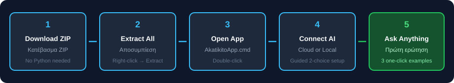
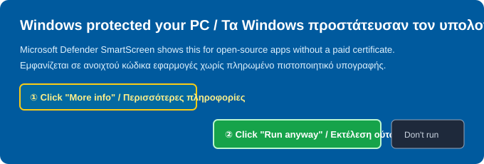
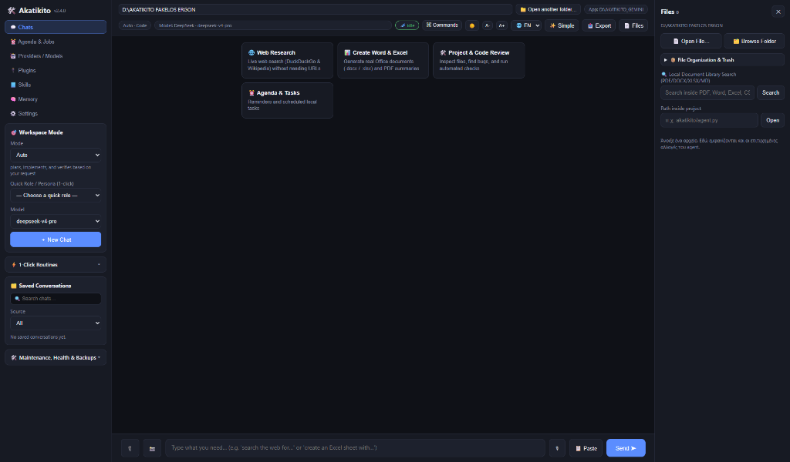

# Πώς ξεκινάω με το Akatikito (σε 5 λεπτά)

> **Δεν χρειάζεται να εγκαταστήσεις Python**, δεν χρειάζεται διαχειριστής (Administrator) και όλα τα προσωπικά σου δεδομένα μένουν στον υπολογιστή σου.
> English guide: [GETTING-STARTED.en.md](GETTING-STARTED.en.md)

---

## 1. Κατέβασμα
Κατέβασε το τελευταίο αρχείο **`Akatikito-v2.6.1-portable.zip`** από τη σελίδα [GitHub Releases](https://github.com/rodos4312/akatikito-ai/releases).
Περιέχει ήδη τη δική του ενσωματωμένη Python 3.11 και όλα τα απαραίτητα πακέτα.

## 2. Αποσυμπίεση
Κάνε δεξί κλικ στο αρχείο `.zip` → **Εξαγωγή όλων (Extract All)** σε έναν απλό φάκελο, π.χ. `C:\Akatikito` ή `Desktop\Akatikito`.
*(Μην ανοίγεις την εφαρμογή μέσα από το συμπιεσμένο `.zip` χωρίς πρώτα αποσυμπίεση.)*

## 3. Άνοιγμα (και τι κάνω αν εμφανιστεί το Windows SmartScreen)
Μέσα στον φάκελο `Akatikito`, κάνε διπλό κλικ στο **`AkatikitoApp.cmd`**.

Αν τα Windows εμφανίσουν μπλε παράθυρο **Windows SmartScreen («Άγνωστος εκδότης»)**:
1. Πάτησε **«Περισσότερες πληροφορίες»** (*More info*).
2. Πάτησε **«Εκτέλεση ούτως ή άλλως»** (*Run anyway*).

*(Αυτό συμβαίνει επειδή το Akatikito είναι δωρεάν εφαρμογή ανοιχτού κώδικα χωρίς πληρωμένο εμπορικό πιστοποιητικό υπογραφής. Μπορείς πάντα να ελέγξεις την ακεραιότητα του zip με το `SHA256SUMS.txt`.)*

## 4. Σύνδεση με AI (2 απλές επιλογές)
Την πρώτη φορά ανοίγει ο απλός οδηγός **«Πώς θέλεις να δουλεύει;»** (μπορείς να αλλάξεις γλώσσα πάνω δεξιά):
- **Με λογαριασμό AI** (OpenAI, Anthropic, Google Gemini, DeepSeek): πάτησε τον σύνδεσμο του παρόχου, αντέγραψε το κλειδί σου και επικόλλησέ το.
- **Τοπικά στον υπολογιστή μου (δωρεάν)**: το Akatikito ελέγχει αν τρέχει ήδη Ollama ή LM Studio στον υπολογιστή σου. Αν δεν υπάρχει, σου δείχνει τους επίσημους συνδέσμους (ποτέ δεν κατεβάζει τίποτα μόνο του).
- **Για προχωρημένους**: ανοίγει ο πλήρης τεχνικός οδηγός.

## 5. Η πρώτη σου ερώτηση
Με το που συνδεθείς, θα δεις 3 έτοιμα κουμπιά για να ξεκινήσεις με ένα κλικ:
- **«Τι μπορείς να κάνεις;»**
- **«Θυμήσου ότι προτιμώ σύντομες απαντήσεις στα ελληνικά»**
- **«Βοήθησέ με με ένα email»**

---

## Τι δεδομένα μένουν στον υπολογιστή σου;
- Όλα τα δεδομένα σου (ρυθμίσεις, κλειδιά κρυπτογραφημένα με **Windows DPAPI**, μνήμη, συζητήσεις, προφίλ οικογένειας) αποθηκεύονται **αποκλειστικά τοπικά** στον φάκελο **`data/`** μέσα στον φάκελο της εφαρμογής.
- **Δεν υπάρχει τηλεμετρία** και τίποτα δεν αποστέλλεται σε κανέναν server χωρίς δική σου ενέργεια (μόνο οι ερωτήσεις που στέλνεις στον πάροχο AI που εσύ διάλεξες).
- **Απεγκατάσταση χωρίς απώλεια δεδομένων:** τρέξε το `Uninstall.cmd`. Από προεπιλογή διαγράφει μόνο την εφαρμογή και **κρατάει άθικτο τον φάκελο `data/`**.
- **Κάτι δεν πήγε καλά;** Πάτησε **«🐛 Αναφορά προβλήματος»** στις Ρυθμίσεις (ή σε οποιοδήποτε μήνυμα σφάλματος): βλέπεις προεπισκόπηση χωρίς κλειδιά, διαδρομές χρήστη ή email, αποθηκεύεις το zip και ανοίγεις έτοιμο GitHub issue με ένα κλικ.
