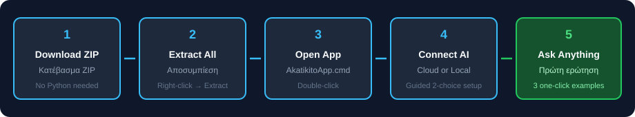
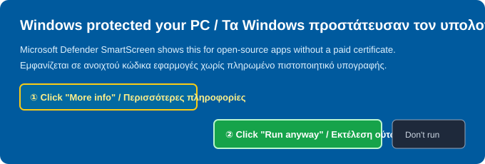
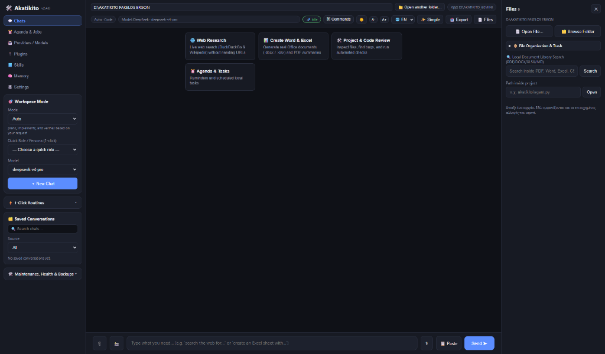

# Getting Started with Akatikito (in 5 Minutes)

> **No Python installation needed**, no administrator rights required, and all your personal data stays locally on your PC.
> Ελληνικός οδηγός: [GETTING-STARTED.el.md](GETTING-STARTED.el.md)

---

## 1. Download
Download the latest **`Akatikito-v2.5.0-portable.zip`** from [GitHub Releases](https://github.com/rodos4312/akatikito-ai/releases).
It already bundles its own embedded Python 3.11 runtime and every required package.

## 2. Extract
Right-click the `.zip` file → **Extract All** into a regular folder such as `C:\Akatikito` or `Desktop\Akatikito`.
*(Always extract before launching — do not run directly inside the compressed ZIP preview.)*

## 3. Open (and Windows SmartScreen "Unknown publisher")
Open the extracted `Akatikito` folder and double-click **`AkatikitoApp.cmd`**.

If Windows shows the blue **Windows SmartScreen ("Windows protected your PC")** notice:
1. Click **More info**.
2. Click **Run anyway**.

*(This warning appears for free open-source Windows apps that are not signed with a paid commercial certificate. You can verify the ZIP integrity anytime using `SHA256SUMS.txt`.)*

## 4. Connect AI (2 Simple Choices)
On first launch, Akatikito asks **"How would you like it to work?"** (you can switch between 6 languages right on the first screen):
- **With an AI account** (OpenAI, Anthropic, Google Gemini, DeepSeek): follow the official link to copy your key and paste it in.
- **Locally on my computer (free, slower)**: Akatikito checks if Ollama or LM Studio is already running on your PC. If not, it shows the official links (it never downloads anything automatically).
- **Advanced setup**: opens the full 4-step technical wizard.

## 5. Ask Your First Question
As soon as you connect, click any of the 3 starter examples:
- **"What can you do?"**
- **"Remember that I prefer concise answers"**
- **"Help me draft an email"**

---

## What Data Stays on Your Computer?
- Everything (settings, **Windows DPAPI**-encrypted API keys, memory, chat history, family profiles) stays **strictly local** in the **`data/`** folder inside your Akatikito directory.
- **Zero telemetry**: nothing ever leaves your PC automatically — only prompts you choose to send to the AI provider you selected.
- **Safe Uninstall**: run `Uninstall.cmd`. By default it removes only the app files and **preserves your `data/` folder**.
- **Hit a problem?** Click **«🐛 Report a problem»** in Settings (or on any error banner): you inspect a sanitized preview (no keys, usernames, emails, or memory), save the ZIP, and optionally open a pre-filled GitHub issue.
